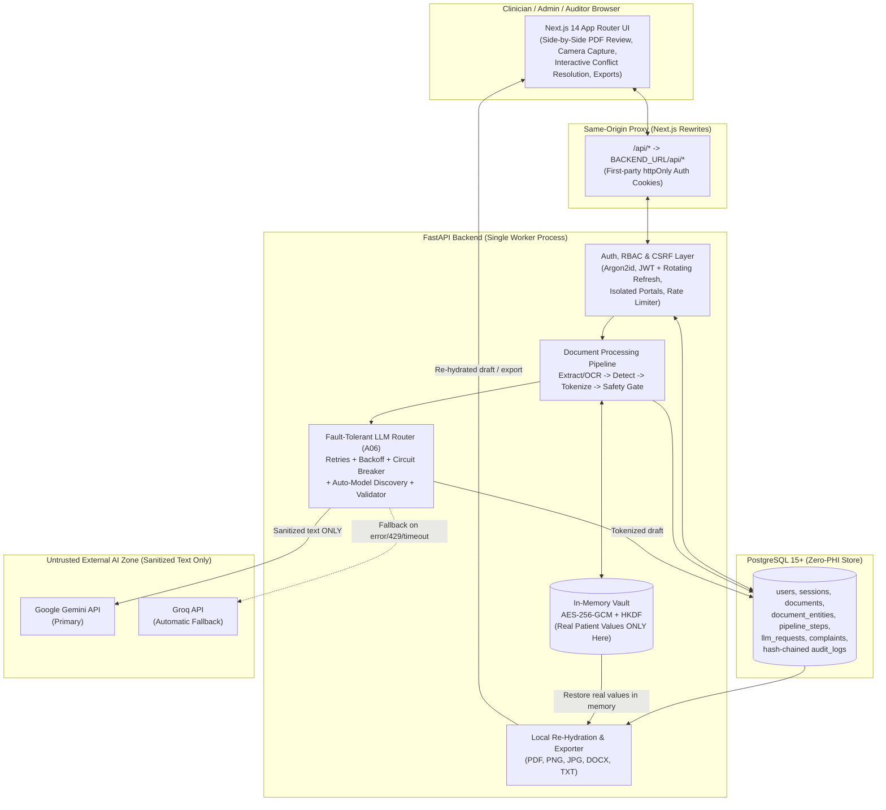
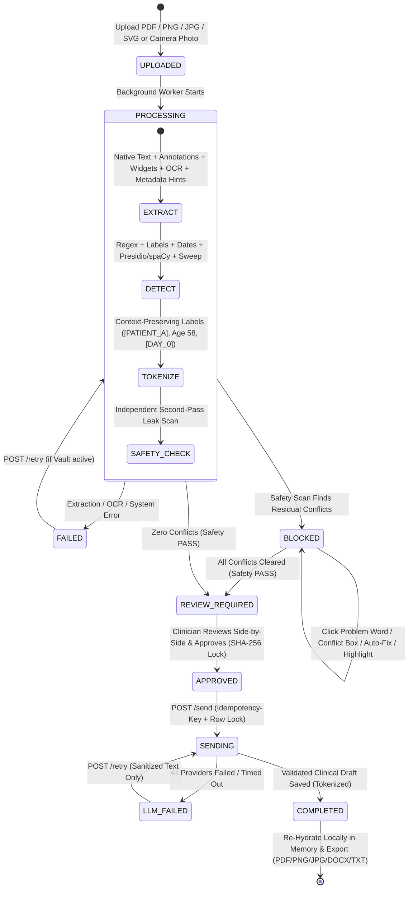
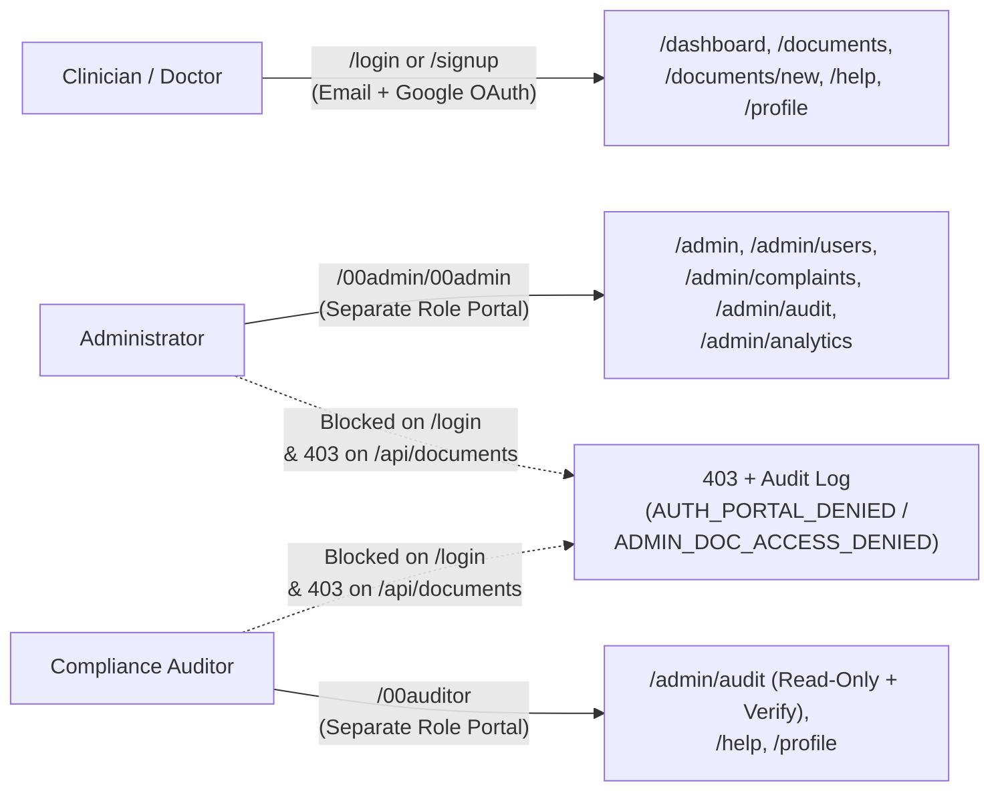

# JOGGO — Privacy-First Clinical AI Gateway

> **Use AI on patient records. Without exposing patients.**
>
> **Demo environment — use synthetic data only.**

JOGGO is a privacy-first clinical document de-identification, clinician review, AI drafting, and local re-hydration gateway built with **Next.js 14 (App Router)**, **FastAPI**, and **PostgreSQL 15**.

- **Event:** Hack the Vibe 2026 (CODE-ARENAX)
- **Track:** World Problem Solver (Health Safety)
- **Declared Advanced Challenges:** **A03** (Security & Access Control) and **A06** (External API & Fault Tolerance)
- **Additional Implemented Pillars:** **A02** (Explainable Detection Rules), **A05** (Concurrency & Idempotency), **A07** (Resumable Workflow), **A08-lite** (SQL Aggregate Analytics)

---

## Table of Contents

1. [The Problem](#the-problem)
2. [The Solution](#the-solution)
3. [System Architecture & Trust Boundaries](#system-architecture--trust-boundaries)
4. [System Diagrams](#system-diagrams)
   - [High-Level System Architecture](#high-level-system-architecture)
   - [6-Stage Document Pipeline & Zero-PHI Data Flow](#6-stage-document-pipeline--zero-phi-data-flow)
   - [Role-Based Access & Isolated Portal Flow](#role-based-access--isolated-portal-flow)
5. [Core Capabilities](#core-capabilities)
6. [Possibilities & Future Roadmap](#possibilities--future-roadmap)
7. [Technology Stack](#technology-stack)
8. [Local Setup & Quick Start](#local-setup--quick-start)
9. [Environment Variables](#environment-variables)
10. [Deployment Guide (Render + Vercel)](#deployment-guide-render--vercel)
11. [Security & Fault-Tolerance Model](#security--fault-tolerance-model)
12. [API Overview](#api-overview)
13. [Testing & Verification](#testing--verification)
14. [Known Limitations](#known-limitations)

---

## The Problem

Clinicians spend hours every shift writing discharge summaries, case summaries, and treatment plans. Large Language Models (LLMs) dramatically speed up clinical documentation, but standard AI tools create four severe patient-safety and compliance risks:

1. **Direct PHI Leakage into Third-Party AI Tools:** Pasting patient PDFs or lab reports into consumer or cloud LLMs exposes Protected Health Information (PHI)—names, dates of birth, phone numbers, addresses, and Medical Record Numbers (MRNs).
2. **Shadow AI from Blanket Bans:** When hospitals ban AI completely without offering a safe alternative, overloaded clinicians are pushed toward slow manual paperwork or unmonitored personal workarounds.
3. **Naive Redaction Breaks Clinical Meaning:** Replacing every identifier with generic `[REDACTED]` blocks erases patient ages, visit timelines, and recurring clinician/patient references—making generated summaries clinically inaccurate.
4. **Hidden Identifiers Outside Main Paragraphs:** Real clinical PDFs and photos hide names inside PDF author metadata, XMP creators, annotations, form widgets, scanned headers, and embedded images that quick manual checks miss.

---

## The Solution

JOGGO acts as a **zero-PHI clinical AI gateway** sitting between the clinician and external AI writing models:

1. **Local Multi-Format Extraction & OCR:** Accepts **PDF, PNG, JPG, SVG**, or direct **live camera capture**. Extracts native text, PDF annotations, form fields, embedded image OCR, EXIF/PNG/XMP author metadata hints, and full-page Tesseract OCR—entirely in memory with zero patient files written to disk.
2. **Context-Preserving HIPAA-18 De-Identification:** Combines regex rules, labeled clinical field detection, relative date parsing, Microsoft Presidio + spaCy NER, and sweep matching to replace identifiers with consistent, meaning-preserving labels:
   - Patient names → `[PATIENT_A]`, doctors → `[DOCTOR_1]`, facilities → `[FACILITY_1]`
   - Dates of birth → `Age 58` (or `Age 90+` per HIPAA Safe Harbor)
   - Visit & lab dates → `[DAY_0]`, `[DAY_3]`, `[DAY_14]` (preserving exact clinical timelines!)
3. **Independent Second-Pass Safety Gate:** Re-scans the cleaned copy for literal leaks, name fragments, residual patterns, and missed entities before unlocking approval.
4. **Interactive Human-in-the-Loop Resolution:** Side-by-side non-copyable PDF-style review sheets where any flagged conflict renders as a clickable red problem word and clickable **Conflict Box** (`Click box to resolve` or `Auto-fix all` line-by-line), plus highlight-to-hide manual marking.
5. **Ephemeral AES-256-GCM In-Memory Vault:** Real patient values live **only** in per-session HKDF-derived AES-256-GCM encrypted RAM—never stored in PostgreSQL, logs, or audit records—and are automatically wiped on logout, idle timeout, account restriction, or server restart.
6. **Fault-Tolerant AI Drafting & Local Re-Hydration:** Sends **only plain sanitized text** + static clinical headings to **Gemini** (primary) with automatic **Groq** fallback, retries, circuit breaker, live model auto-discovery, and Markdown validation. Real patient details are restored locally on the clinician's screen and exported cleanly as **PDF, PNG, JPG, DOCX, or TXT**.

---

## System Architecture & Trust Boundaries

| Zone | Components | What Lives Here | Strict Guarantees |
| :--- | :--- | :--- | :--- |
| **Trusted Zone** | Browser UI (Next.js) + FastAPI Backend (single worker) + In-Memory AES-256-GCM Vault | Original files, extracted text, token-to-value mapping, re-hydrated drafts on screen | HKDF per-`(session, doc)` AES-256-GCM encryption; idle/age TTL + LRU eviction; wiped on logout, restriction, or restart |
| **Persistent Database** | PostgreSQL 15+ | Users, hashed refresh sessions, sanitized text (only after Safety `PASS`), tokenized LLM output, entity metadata (no values), pipeline steps, complaints, hash-chained audit logs | **Zero real patient values (PHI)** ever written to any column; append-only `audit_logs` protected by DB trigger |
| **Untrusted Zone** | External LLM APIs (Google Gemini, Groq) | Static clinical system prompt + required Markdown headings + `sanitized_text` | **Never** receives original PDFs/images, real names/IDs, filenames, user emails, user IDs, or document IDs |

---

## System Diagrams

### High-Level System Architecture



### 6-Stage Document Pipeline & Zero-PHI Data Flow



### Role-Based Access & Isolated Portal Flow



---

## Core Capabilities

- **Multi-Format Clinical Ingestion:** Upload **PDF, PNG, JPG, or SVG** files (up to 10 MB / 30 PDF pages) or capture printed pages directly via the built-in **live device camera viewfinder** with animated upload & privacy-scan progress.
- **Bangla (labels, digits, OCR):** Detects Bangla-script clinical labels (`রোগীর নাম`, `পিতার নাম`, `ডাক্তার`, `মোবাইল`, `ঠিকানা`, `এনআইডি`, `রেজি নং`, `জন্ম তারিখ`, `ভর্তির তারিখ`), Bangla title prefixes, Bangla digits (`০–৯`), Unicode-aware literal sweeps, manual marking, and local `eng+ben` Tesseract OCR.
- **Interactive Conflict Resolution:** When the safety gate flags leftover personal details, JOGGO clearly displays **"Verdict: Manual resolution required"**, turns every flagged word inline into a clickable red button, renders each conflict as an interactive **Conflict Box** (`Click box to resolve` + `Locate`), and supports **Auto-fix all** sequential resolution as well as manual text highlighting.
- **Protected Side-by-Side Review:** Non-copyable PDF-style preview sheets (`.cs-no-copy` with clipboard/shortcut guards) let clinicians verify the **Cleaned Copy** against the **Original Document** (text view or embedded original file) plus an explainability drawer (**"Why were these details hidden?"**).
- **Clinical Draft Generation, Approved External Handoff & Multi-Format Export:** Generates structured **Discharge Summaries**, **Case Summaries**, and **Treatment Plans** via Gemini/Groq with automatic fallback, supports an approval-gated & audited external web AI handoff (`POST /api/documents/{id}/handoff`, audit action `DOC_EXTERNAL_HANDOFF`) using sanitized text only, and exports re-hydrated drafts as **PDF, PNG, JPG, DOCX, or TXT**.
- **Separate Role Portals & Tamper-Evident Compliance:** Separate role portals for clinicians (`/login`), administrators (`/00admin/00admin`), and auditors (`/00auditor`) — access is enforced on the server; strict zero-document access for admins/auditors; PostgreSQL trigger-protected, SHA-256 hash-chained `audit_logs` verifiable via `GET /api/audit/verify`; 13-week activity heatmaps and zero-PHI admin analytics.
- **Responsive Mobile-First UI:** Full mobile navigation drawers, responsive split-pane tabs, touch-friendly controls, and zero horizontal overflow across phone, tablet, and desktop screens.

---

## Possibilities & Future Roadmap

JOGGO's clean separation between local extraction/vaulting and external LLM inference opens up high-impact production extensions:

- **Direct EHR / FHIR Integration:** Connect via HL7 FHIR (`DocumentReference`, `Composition`, `DiagnosticReport`) so clinicians pull notes directly from Epic, Cerner, or OpenMRS and write signed drafts back into the chart.
- **Self-Hosted & On-Premise LLMs:** Swap or prepend an internal **vLLM / Ollama / Vertex AI Private Endpoint** provider into `LLM_PROVIDER_ORDER` for hospitals requiring 100% air-gapped inference with zero external egress.
- **Multi-Language Clinical OCR & NER:** Extend `OCR_LANGS` (e.g., `eng+ben+ara+spa`) and multilingual NER models for regional hospitals and bilingual prescriptions/handwritten notes.
- **Medical Imaging & DICOM Header Scrubbing:** Extend the ingestion pipeline to strip burnt-in pixel text and DICOM metadata tags from X-ray, CT, and ultrasound reports.
- **Enterprise Distributed Vault (Redis KMS / HSM):** Upgrade the in-process AES-256-GCM Vault to an encrypted, short-TTL Redis/KMS store to support multi-worker horizontal scaling behind Kubernetes load balancers.
- **Clinician Template Builder & Batch Queues:** Let hospital departments define custom note templates (SOAP notes, referral letters, insurance prior authorizations) and process multi-patient ward rounds in parallel.

---

## Technology Stack

| Layer | Technologies |
| :--- | :--- |
| **Frontend** | Next.js 14 (App Router), React 18, TypeScript, Tailwind CSS, TanStack Query, React Hook Form + Zod, Lucide Icons |
| **Backend** | FastAPI, Python 3.11, SQLAlchemy 2.0, Alembic, Pydantic v2, `httpx`, `slowapi`, `argon2-cffi`, `PyJWT` |
| **OCR & NLP** | PyMuPDF (`pymupdf`), Tesseract OCR (`pytesseract`, `tesseract-ocr-eng`, `tesseract-ocr-ben`), Pillow, Microsoft Presidio, spaCy (`en_core_web_sm`), Unicode `regex` |
| **Document Export** | ReportLab (PDF), PyMuPDF + Pillow (PNG/JPG rasterization), `python-docx` (DOCX), UTF-8 TXT |
| **Database & Security** | PostgreSQL 15+, AES-256-GCM + HKDF (`cryptography`), SHA-256 Hash-Chained Audit Log |
| **AI Providers** | Google Gemini (`gemini-2.5-flash` + live model auto-discovery) → Groq (`llama-3.3-70b-versatile` + live model auto-discovery) |
| **Infrastructure** | Docker Compose (local), Render (Docker backend + PostgreSQL), Vercel (Next.js frontend) |

---

## Local Setup & Quick Start

### Prerequisites
- Docker & Docker Compose
- At least one AI API key (**Google AI Studio Gemini** or **GroqCloud**) for live draft generation

### Run Locally

```bash
# 1. Copy environment template
cp .env.example .env

# 2. Edit .env and add GEMINI_API_KEY and/or GROQ_API_KEY
#    (Default models gemini-2.5-flash and llama-3.3-70b-versatile are built in.)

# 3. Build and start PostgreSQL, FastAPI backend, and Next.js frontend
docker compose up --build
```

- **Web App:** `http://localhost:3000`
- **Backend Health:** `http://localhost:8000/api/health` (and same-origin `http://localhost:3000/api/health`)
- **Swagger Docs (dev only):** `http://localhost:8000/api/docs`

---

## Environment Variables

See [`.env.example`](.env.example). Never commit `.env` or real secrets.

| Variable | Description | Example / Default |
| :--- | :--- | :--- |
| `DATABASE_URL` | PostgreSQL 15+ connection URL (`postgres://` auto-normalized to `postgresql+psycopg://`) | `postgresql+psycopg://clinicshield:clinicshield@db:5432/clinicshield` |
| `JWT_SECRET` | Random 32+ character JWT signing secret | `change-me-32-chars-minimum` |
| `FRONTEND_ORIGIN` | Allowed CSRF `Origin` (supports comma-separated origins) | `http://localhost:3000` |
| `BACKEND_URL` | Backend base URL used by Next.js `/api/:path*` rewrites | `http://localhost:8000` |
| `GEMINI_API_KEY` | Google AI Studio API key (primary LLM) | *(secret)* |
| `GEMINI_MODEL` | Gemini model ID (auto-discovers live model on 404/deprecation) | `gemini-2.5-flash` |
| `GROQ_API_KEY` | GroqCloud API key (fallback LLM) | *(secret)* |
| `GROQ_MODEL` | Groq model ID (auto-discovers live model on 404/decommission) | `llama-3.3-70b-versatile` |
| `LLM_PROVIDER_ORDER` | Comma-separated failover order | `gemini,groq` |
| `OCR_LANGS` | Local Tesseract OCR languages (English + Bangla) | `eng+ben` |
| `PIPELINE_MAX_WORKERS` | Pipeline worker thread cap (defaults to `2` in `prod`, `4` in `dev`) | `2` (prod) / `4` (dev) |
| `GOOGLE_CLIENT_ID` | Google OAuth 2.0 Web Client ID (also exposed at runtime via `/api/auth/config`) | *(optional)* |
| `NEXT_PUBLIC_GOOGLE_CLIENT_ID` | Optional build-time Google Client ID for Vercel frontend | *(optional)* |
| `ADMIN_SEED_EMAIL` / `ADMIN_SEED_PASSWORD` | Optional initial Admin account seed | *(optional)* |
| `AUDITOR_SEED_EMAIL` / `AUDITOR_SEED_PASSWORD` | Optional initial Auditor account seed | *(optional)* |
| `DOCTOR_SEED_EMAIL` / `DOCTOR_SEED_PASSWORD` | Optional initial Doctor demo account seed | *(optional)* |

---

## Deployment Guide (Render + Vercel)

### 1. Backend + PostgreSQL on Render
1. Provision a **Render PostgreSQL 15+** database.
2. Create a **Docker Web Service** connected to your repository:
   - **Root Directory:** *(leave blank — repo root `.`)*
   - **Dockerfile Path:** `./backend/Dockerfile`
   - **Docker Build Context Directory:** `.`
3. Set environment variables: `ENV=prod`, `DATABASE_URL`, `JWT_SECRET`, `FRONTEND_ORIGIN` (your Vercel URL), `GEMINI_API_KEY`, `GROQ_API_KEY`, `GOOGLE_CLIENT_ID` (optional), and seed credentials.
4. Container startup automatically runs:
   `alembic upgrade head && python scripts/seed.py && uvicorn app.main:app --host 0.0.0.0 --port ${PORT:-8000} --workers 1`
   *(`--workers 1` is required so the in-memory AES-256-GCM Vault stays consistent within one process; `MALLOC_ARENA_MAX=2`, singleton spaCy/Presidio loading, 200 DPI OCR cap, and `PIPELINE_MAX_WORKERS=2` in `prod` keep memory well inside the 512 MB free tier.)*
5. **Keep-Alive Workflow:** `.github/workflows/keepalive.yml` runs every 10 minutes via GitHub Actions cron (no secrets needed) and pings `GET https://joggo-nine.vercel.app/api/health` to reduce free-tier cold starts.

### 2. Frontend on Vercel
1. Import the repository in Vercel and set **Root Directory** to `frontend`.
2. Set `BACKEND_URL` to your Render service URL (e.g. `https://joggo.onrender.com`) and optionally `NEXT_PUBLIC_GOOGLE_CLIENT_ID`.
3. `frontend/next.config.js` proxies `/api/:path*` → `${BACKEND_URL}/api/:path*`, keeping `httpOnly` session cookies first-party and same-origin.

---

## Security & Fault-Tolerance Model

### A03 — Security & Access Control
- **Authentication & Sessions:** Argon2id password hashing (`argon2-cffi`), 15-minute access JWT + 7-day 256-bit refresh token stored solely as SHA-256 hashes, refresh rotation with reuse detection (revokes full session family and wipes Vault), and 15-minute lockout after 5 failed attempts.
- **Role & Portal Access Control:** User role, status, and `token_version` are verified from PostgreSQL on every request; non-owner document access returns `404` + `DOC_ACCESS_DENIED`; admin/auditor document endpoints return `403 ADMIN_NO_DOCUMENT_ACCESS` + `ADMIN_DOC_ACCESS_DENIED`; `/00admin/00admin` and `/00auditor` are separate role portals; access is enforced on the server (`AUTH_PORTAL_DENIED` on mismatch).
- **Approved & Audited External Handoff:** `POST /api/documents/{id}/handoff` requires owner + active status, `safety_report.status == "PASS"`, matching `sanitized_sha256`, explicit clinician confirmation checkbox, CSRF, and rate limiting; returns server-built sanitized `prompt_text` and records `DOC_EXTERNAL_HANDOFF` (provider metadata only, never text or filename).
- **CSRF, Headers & Rate Limiting:** All state-changing endpoints require `X-Requested-With: fetch` and a matching `Origin` (or `Referer` fallback); backend responses enforce `X-Content-Type-Options: nosniff`, `X-Frame-Options: SAMEORIGIN`, `Referrer-Policy: no-referrer`, and `Cache-Control: no-store` on `/api`; Next.js page responses add `Strict-Transport-Security`, `Permissions-Policy`, and strict `Content-Security-Policy`; `slowapi` rate limits return `429` with `Retry-After`.
- **Tamper-Evident Audit Log:** PostgreSQL `BEFORE UPDATE OR DELETE` trigger blocks log tampering; SHA-256 hash chain serialized via `pg_advisory_xact_lock(7001)` and independently verifiable via `GET /api/audit/verify`.

### A06 — External API & Fault Tolerance
- **Resilient LLM Router:** Gemini primary → Groq fallback, explicit `httpx` timeouts (`10s` connect / `45s` read), up to 3 attempts per provider with exponential backoff (`1s, 2s, 4s` + jitter) and `Retry-After` honoring (capped at 10s), per-provider circuit breaker (5 failures in 60s → open 30s → half-open trial), live model auto-discovery on 404/decommissioned models, resilient Markdown heading validation + single repair retry, global `Semaphore(4)`, and safe retry via `POST /api/documents/{id}/retry`.
- **Idempotency & Concurrency (A05):** `POST /api/documents/{id}/send` requires `Idempotency-Key`, uses `SELECT ... FOR UPDATE`, and enforces atomic state transitions (`backend/app/services/state.py`).

---

## API Overview

| Group | Key Endpoints |
| :--- | :--- |
| **Health & Auth** | `GET /api/health`, `GET /api/auth/config`, `POST /api/auth/{signup,login,google,refresh,logout}` |
| **Profile & Sessions** | `GET/PATCH /api/me`, `POST /api/me/password`, `GET /api/me/sessions`, `DELETE /api/me/sessions/{id}` |
| **Documents & Pipeline** | `GET/POST /api/documents`, `GET/DELETE /api/documents/{id}`, `GET /api/documents/{id}/{steps,original-text,original-pdf,sanitized,result}`, `POST /api/documents/{id}/{manual-marks,approve,send,handoff,retry}`, `GET /api/documents/{id}/export?format=pdf\|png\|jpg\|docx\|txt` |
| **Dashboard & Support** | `GET /api/dashboard`, `GET/POST /api/complaints`, `GET /api/complaints/{id}`, `POST /api/complaints/{id}/messages` |
| **Admin & Audit** | `GET /api/admin/{overview,analytics,users,complaints}`, `PATCH /api/admin/users/{id}`, `PATCH /api/admin/complaints/{id}/status`, `GET /api/audit`, `GET /api/audit/verify` |

---

## Testing & Verification

Backend tests run against PostgreSQL (never SQLite) with mocked LLM providers (**44/44 tests passing, 90% backend coverage**):

```bash
# Run full backend test suite (44/44 tests)
docker compose exec backend pytest -v

# Backend coverage report (90% total coverage)
docker compose exec backend pytest --cov=app --cov-report=term-missing

# Frontend TypeScript & ESLint verification
docker compose exec frontend npm run typecheck
docker compose exec frontend npm run lint

# Generate synthetic sample PDF fixtures
docker compose exec backend python scripts/make_sample_pdfs.py

# Live LLM smoke test (uses synthetic tokenized text only; requires API keys)
docker compose exec backend python scripts/smoke_llm.py
```

---

## Known Limitations

- Automated identifier detection combines rules and lightweight NLP and is never 100% infallible; mandatory clinician review and a second-pass safety scan are strictly enforced before any LLM request.
- Unlabelled Bangla names in free text may need manual marking.
- Python cannot guarantee deterministic zeroing of freed RAM pages; the AES-256-GCM in-memory Vault is best-effort ephemeral memory protection.
- Vault data clears on server restart (previously completed documents gracefully display safe placeholders).
- No email-based password reset or un-marking of already-masked tokens in this demo release.
- Free-tier cloud hosts sleep after inactivity (`.github/workflows/keepalive.yml` pings `GET https://joggo-nine.vercel.app/api/health` every 10 minutes to minimize cold starts).
- **Demo environment — use synthetic data only.**
